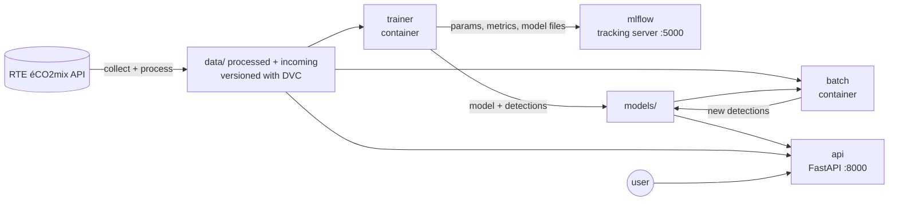

# Grid anomaly detection (France, RTE éCO2mix)

Detects abnormal behaviour in French national electricity consumption at
30-minute resolution, and runs the whole lifecycle as an MLOps pipeline:
versioned data, tracked training, batch prediction on new data, and an API
that serves the results.

## Project status

| Phase | Content | Status |
|---|---|---|
| **1** | Scoping, objectives and metrics; RTE data collected and cleaned (UTC 30-minute grid, clock-change fix, validation); MSTL detector and two baselines evaluated on reference events; read-only FastAPI service; unit tests | ✅ done |
| **2** | Docker services (MLflow, trainer, batch, API), MLflow tracking, DVC data versioning, 80/20 split with batch prediction on new data | ✅ done · promote-or-reject retraining in progress |
| **3** | Airflow DAGs for batch prediction and retraining, API endpoints to trigger them, API security, CI with GitHub Actions | ⏳ next |
| **4** | Prometheus + Grafana monitoring, drift detection, Streamlit dashboard | ⏳ planned |

## Architecture



| Service | What it does | Runs |
|---|---|---|
| `mlflow` | Tracking server: every training run with its parameters, metrics and model files | always |
| `trainer` | Job: downloads and cleans the data if missing, trains, logs to MLflow, writes `models/` | once, then exits |
| `batch` | Job: new data arrives (next 7 days by default), the **saved** model scores only those half-hours | on demand |
| `api` | FastAPI: serves stored results; re-reads files when they change (no restart needed) | always |

Containers share the `data/` and `models/` folders. Each service has its own
small image on `python:3.12-slim` with only the packages it needs.

## How the detection works

Three detectors build an expected value for every half-hour and flag a point
when the gap is far from the usual gap:

**z = (gap − median of gaps) / (1.4826 × MAD of gaps)**, flag when |z| > K, with **K = 4**.

| Detector | Expected value | Role |
|---|---|---|
| `mstl` | trend + daily (48) + weekly (336) cycles, removed with MSTL | **main detector** |
| `forecast_gap` | RTE day-before forecast (`prevision_j1`) | baseline |
| `last_week` | same half-hour 7 days earlier | baseline |

**Why K = 4:** the reference value for this "modified z-score" is 3.5
(Iglewicz & Hoaglin, 1993, *How to Detect and Handle Outliers*). K = 4 is a
little stricter to keep false alarms low (about 17,500 half-hours per year).
A sweep over K = 2–6 for all three detectors (`src/models/compare.py`, 15 MLflow
runs in the experiment `detector-comparison`) confirms it gives the best balance
between events caught and false alarms (K = 3: more events but more than twice
as many false alarms). Run it with
`docker compose run --rm trainer python -m src.models.compare`.

## Data

- RTE éCO2mix national: consolidated/definitive history plus real-time data
  (Opendatasoft exports, no API key).
- 30-minute grid in UTC from 1 Jan 2023 to 12 Oct 2026 (66,258 measured
  half-hours). Clock-change duplicates are dropped, gaps up to 2 hours are
  interpolated and marked `was_filled`, rows after the last measurement are
  RTE forecasts marked `is_future`.
- French public holidays by Paris date (`holidays` package).
- **80/20 split** to simulate new data: `data/processed/` holds 1 Jan 2023 →
  8 Jan 2026 (training, 52,990 half-hours); `data/incoming/` holds 9 Jan →
  13 Oct 2026 (13,342 half-hours) that "arrive" week by week.
- All three folders (`raw`, `processed`, `incoming`) are versioned with **DVC**;
  the data is stored on **DagsHub** (https://dagshub.com/appliedmath/eco2mix-anomaly).

## Results

Evaluated on reference events (French public holidays and clock-change days).
Recall = share of events with at least one alert inside. False alarms =
alert episodes outside every event, per week (consecutive alerts count once).

| Detector | All data (47 events) | | 80% training part (39 events) | |
|---|---|---|---|---|
| | Recall | False alarms / week | Recall | False alarms / week |
| `mstl` | **0.745** (35/47) | 0.45 | **0.692** (27/39) | 0.51 |
| `forecast_gap` | 0.085 (4/47) | 0.12 | 0.077 (3/39) | 0.16 |
| `last_week` | 0.191 (9/47) | 0.46 | 0.154 (6/39) | 0.50 |

Reading these numbers:

- The detectors don't know about holidays: a holiday on a weekday looks like
  a Sunday. `mstl` catches most holidays (holiday recall 0.875), which shows
  it reacts to a known calendar effect — not that it finds real incidents.
  Example: 14 July 2024 (a Sunday) is not flagged, 14 July 2026 (a Tuesday) is.
- Clock-change recall is 0 for all three detectors (highest |z| on those days
  is between 1.5 and 3.4).
- Many `mstl` alert episodes outside the reference events are long and fall
  between November and January (cold weather is a likely cause, not checked),
  so "false alarm" is an upper bound.
- `last_week` over-flags when the weather changes between two weeks (first
  batch, 9–15 Jan 2026: 142 flagged half-hours vs 23 for `mstl`).

## Run it with Docker

Requirements: Docker Desktop (with WSL integration on Windows), Git, Python 3.12
with `uv` (only for DVC and tests).

```bash
git clone git@github.com:appliedmath/eco2mix-anomaly.git
cd eco2mix-anomaly
uv venv --python 3.12 && source .venv/bin/activate
uv pip install -r requirements-dev.txt     # includes dvc
dvc pull                                    # data/raw, processed, incoming (from DagsHub)

docker compose up -d --build                # mlflow, then trainer, then api
docker compose ps -a                        # trainer "Exited (0)", others "Up"
```

- MLflow: http://localhost:5000 (Model training → Runs)
- API docs: http://localhost:8000/docs

Without `dvc pull`, the trainer downloads the data from RTE itself.

### DVC storage on DagsHub (one-time setup)

The data is stored on DagsHub; the remote `dagshub` is already the default in
`.dvc/config`. Each team member adds their own token once (DagsHub → avatar →
Your Settings → Tokens). The token goes into `.dvc/config.local`, which git
ignores, never into a tracked file:

```bash
read -s DAGSHUB_TOKEN                      # paste the token, press Enter (nothing is shown)
dvc remote modify dagshub --local auth basic
dvc remote modify dagshub --local user <your-dagshub-username>
dvc remote modify dagshub --local password "$DAGSHUB_TOKEN"
dvc pull                                    # download the data
dvc push                                    # upload after `dvc add` / `dvc commit`
```

A local backup remote `localstore` is also configured (`dvc push -r localstore`).

### Batch prediction (new data arrives)

```bash
docker compose run --rm batch               # next 7 days arrive and are scored
docker compose run --rm batch sh batch.sh 1 # next day only
```

Before: `/anomaly-day?day=2026-01-12` → "no data". After the batch: a result,
without restarting the API.

### Retrain and reset

```bash
docker compose run --rm trainer             # retrain, new MLflow run
dvc checkout --force                        # back to the clean 80/20 split
docker compose run --rm trainer             # retrain on it
docker compose down                         # stop everything (data and runs are kept)
```

## API

The API only reads files written by the trainer and batch jobs
(`models/detections.parquet`, `models/anomaly_days.csv`, `models/metadata.json`)
and the processed data. It never runs a model itself.

| Endpoint | Returns |
|---|---|
| `GET /health` | status, `model_version`, `last_data` |
| `GET /model-info` | training metadata and metrics |
| `GET /anomaly-day?day=YYYY-MM-DD` | was there an anomaly on this Paris calendar day? Points, max \|z\|, peak time; optional `detector` |
| `GET /anomalies?start=&end=` | flagged half-hours; optional `detector`, `only_anomalies` |
| `GET /series?start=&end=` | consumption and RTE forecasts |

Dates are `YYYY-MM-DD`, both days included, at most 366 days; invalid dates
return 422, a day without data returns 404.

```bash
curl "http://localhost:8000/anomaly-day?day=2026-07-14"
```

## Development without Docker

```bash
source .venv/bin/activate
uv pip install -r requirements.lock.txt
python -m pytest -q                         # all tests
python -m src.models.train                  # train locally (MLflow only if MLFLOW_TRACKING_URI is set)
uvicorn src.api.main:app --reload           # API on http://127.0.0.1:8000/docs
```

**macOS note:** the pinned `scipy 1.15.3` can fail on macOS 27 (`import
statsforecast` raises an ImportError from scipy's `_spropack`). Workaround after
installing from the lock file: `uv pip install scipy==1.18.1`. Don't change the
lock file (`statsforecast 2.0.3` requires `scipy < 1.16`); our own code uses
`statsmodels`. The Docker images are not affected.

## Layout

| Path | Content |
|---|---|
| `src/data/` | `collect.py` (download), `process.py` (30-min grid, flags, validation), `batches.py` (80/20 split, batches) |
| `src/models/` | `detect.py` (MSTL), `train.py`, `compare.py` (detectors × K in MLflow), `predict.py` (batch scoring), `tracking.py` (MLflow), `events.py` (reference events), `anomaly_days.py`, `model.py` |
| `src/api/` | FastAPI service |
| `scripts/` | `split_holdout.py`, `inject_batch.py`, `inspect_alarms.py`, `check_clock_change.py` (clock-change day on fresh RTE data) |
| `docker/` | Dockerfiles, per-service requirements, job scripts |
| `config/` | reference events added by hand |
| `data/*.dvc` | DVC receipts (the data itself is in DVC storage) |
| `notebooks/` | data exploration |
| `tests/` | unit tests |

## Known limitations

- Evaluation is in-sample: thresholds are computed on the data that is scored.
- Reference events are only holidays and clock changes; heatwaves, cold snaps
  and strikes are not in the list yet.
- New data is simulated from the held-back 20%; live collection from RTE is a
  possible next step (RTE revises recent values, so live alerts would be provisional).
- DVC storage is DagsHub (hosted). A production setup would use S3-compatible
  object storage (e.g. MinIO locally, or AWS S3) for both DVC and MLflow artifacts.
- No authentication on the API yet (Phase 3).
