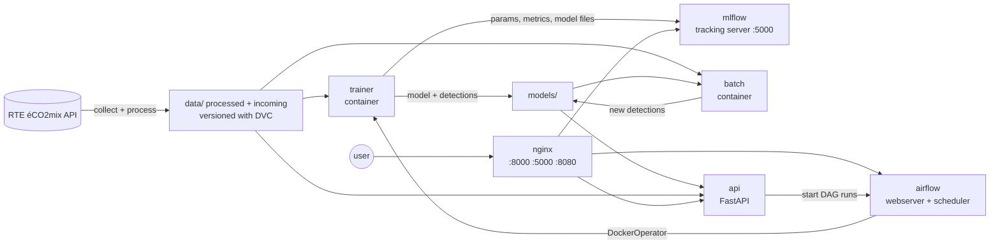

# Grid anomaly detection (France, RTE éCO2mix)

[](https://github.com/appliedmath/eco2mix-anomaly/actions/workflows/ci.yml)

Detects abnormal behaviour in French national electricity consumption at
30-minute resolution, and runs the whole lifecycle as an MLOps pipeline:
versioned data, tracked training, batch prediction on new data, and an API
that serves the results.

## Project status

| Phase | Content | Status |
|---|---|---|
| **1** | Scoping, objectives and metrics; RTE data collected and cleaned (UTC 30-minute grid, clock-change fix, validation); MSTL detector and two baselines evaluated on reference events; read-only FastAPI service; unit tests | ✅ done |
| **2** | Docker services (MLflow, trainer, batch, API), MLflow tracking, DVC data versioning (DagsHub), 80/20 split with batch prediction on new data, promote-or-reject retraining with the MLflow Model Registry | ✅ done |
| **3** | Airflow DAGs for batch prediction and retraining (DockerOperator); API endpoints that start them through Airflow (`POST /train`, `POST /predict`); MLflow model signature; NGINX as single entry point; API key; CI with GitHub Actions | ✅ done (tag `v0.3`) |
| **4** | Prometheus + Grafana monitoring, drift detection, Streamlit dashboard | ⏳ planned |

**Documentation:** [Architecture](docs/architecture.md) (services, who calls
whom, flows, design decisions) · [CI/CD strategy](docs/cicd_strategy.md)
(what happens when code, data or the model change).

## Architecture



| Service | What it does | Runs |
|---|---|---|
| `mlflow` | Tracking server: every training run with its parameters, metrics and model files | always |
| `trainer` | Job: downloads and cleans the data if missing, trains, logs to MLflow; the new model replaces the one in `models/` only if it is not worse | once, then exits |
| `batch` | Job: new data arrives (next 7 days by default), the **saved** model scores only those half-hours | on demand |
| `api` | FastAPI: serves stored results; re-reads files when they change (no restart needed) | always |
| `airflow-*` | Orchestrator: `batch_dag` (daily) and `retrain_dag` (weekly); each task starts the trainer image (DockerOperator) | always (DAGs paused until switched on) |
| `nginx` | Single entry point: the **only** service with ports on your machine; forwards to API, MLflow and Airflow | always |

Containers share the `data/` and `models/` folders. Each service has its own
small image on `python:3.12-slim` with only the packages it needs.

## How the detection works

Three detectors build an expected value for every half-hour and flag a point
when the gap is far from the usual gap:

**z = (gap − median of gaps) / (1.4826 × MAD of gaps)**, flag when |z| > K, with **K = 4**.

| Detector | Expected value | Role |
|---|---|---|
| `mstl` | trend + daily (48) + weekly (336) cycles, removed with MSTL | **main detector** |
| `forecast_gap` | RTE day-before forecast (`prevision_j1`) | baseline |
| `last_week` | same half-hour 7 days earlier | baseline |

**Why K = 4:** the reference value for this "modified z-score" is 3.5
(Iglewicz & Hoaglin, 1993, *How to Detect and Handle Outliers*). K = 4 is a
little stricter to keep false alarms low (about 17,500 half-hours per year).
A sweep over K = 2–6 for all three detectors (`src/models/compare.py`, 15 MLflow
runs in the experiment `detector-comparison`) confirms it gives the best balance
between events caught and false alarms (K = 3: more events but more than twice
as many false alarms). Run it with
`docker compose run --rm trainer python -m src.models.compare`.

## Data

- RTE éCO2mix national: consolidated/definitive history plus real-time data
  (Opendatasoft exports, no API key).
- 30-minute grid in UTC from 1 Jan 2023 to 12 Oct 2026 (66,258 measured
  half-hours). Clock-change duplicates are dropped, gaps up to 2 hours are
  interpolated and marked `was_filled`, rows after the last measurement are
  RTE forecasts marked `is_future`.
- French public holidays by Paris date (`holidays` package).
- **80/20 split** to simulate new data: `data/processed/` holds 1 Jan 2023 →
  8 Jan 2026 (training, 52,990 half-hours); `data/incoming/` holds 9 Jan →
  13 Oct 2026 (13,342 half-hours) that "arrive" week by week.
- All three folders (`raw`, `processed`, `incoming`) are versioned with **DVC**;
  the data is stored on **DagsHub** (https://dagshub.com/appliedmath/eco2mix-anomaly).

## Results

Evaluated on reference events (French public holidays and clock-change days).
Recall = share of events with at least one alert inside. False alarms =
alert episodes outside every event, per week (consecutive alerts count once).

| Detector | All data (47 events) | | 80% training part (39 events) | |
|---|---|---|---|---|
| | Recall | False alarms / week | Recall | False alarms / week |
| `mstl` | **0.745** (35/47) | 0.45 | **0.692** (27/39) | 0.51 |
| `forecast_gap` | 0.085 (4/47) | 0.12 | 0.077 (3/39) | 0.16 |
| `last_week` | 0.191 (9/47) | 0.46 | 0.154 (6/39) | 0.50 |

Reading these numbers:

- The detectors don't know about holidays: a holiday on a weekday looks like
  a Sunday. `mstl` catches most holidays (holiday recall 0.875), which shows
  it reacts to a known calendar effect — not that it finds real incidents.
  Example: 14 July 2024 (a Sunday) is not flagged, 14 July 2026 (a Tuesday) is.
- Clock-change recall is 0 for all three detectors (highest |z| on those days
  is between 1.5 and 3.4).
- Many `mstl` alert episodes outside the reference events are long and fall
  between November and January (cold weather is a likely cause, not checked),
  so "false alarm" is an upper bound.
- `last_week` over-flags when the weather changes between two weeks (first
  batch, 9–15 Jan 2026: 142 flagged half-hours vs 23 for `mstl`).

## Run it with Docker

Requirements:
- Docker Desktop (with WSL integration on Windows) and **at least 8 GB RAM
  available to Docker**. On WSL2, a VM or Docker Desktop for Mac, check that
  8 GB are allocated to it. The whole stack (MLflow, API, Airflow) uses about
  3.6 GB, about 5 GB while a training job runs.
- Git, Python 3.12 with `uv` (only for DVC and tests).

```bash
git clone git@github.com:appliedmath/eco2mix-anomaly.git
cd eco2mix-anomaly
uv venv --python 3.12 && source .venv/bin/activate
uv pip install -r requirements-dev.txt     # includes dvc
dvc pull                                    # data/raw, processed, incoming (from DagsHub)
```

**Set up `.env` once** (works on Linux, WSL and macOS). It writes the values
that depend on your machine and random secrets; nothing of it goes into git:

```bash
cp .env.example .env
rnd() { python3 -c "import secrets; print(secrets.token_urlsafe(${1:-24}))"; }
sed -i.bak \
  -e "s|^HOST_PROJECT_DIR=.*|HOST_PROJECT_DIR=$(pwd)|" \
  -e "s|^AIRFLOW_UID=.*|AIRFLOW_UID=$(id -u)|" \
  -e "s|^DOCKER_GID=.*|DOCKER_GID=$(stat -L -c %g /var/run/docker.sock 2>/dev/null || echo 0)|" \
  -e "s|^API_KEY=.*|API_KEY=$(rnd 32)|" \
  -e "s|^AIRFLOW_ADMIN_PASSWORD=.*|AIRFLOW_ADMIN_PASSWORD=$(rnd)|" \
  -e "s|^AIRFLOW_DB_PASSWORD=.*|AIRFLOW_DB_PASSWORD=$(rnd)|" \
  -e "s|^AIRFLOW_FERNET_KEY=.*|AIRFLOW_FERNET_KEY=$(python3 -c 'import base64,os; print(base64.urlsafe_b64encode(os.urandom(32)).decode())')|" \
  -e "s|^AIRFLOW_SECRET_KEY=.*|AIRFLOW_SECRET_KEY=$(rnd 32)|" \
  -e "s|^GRAFANA_ADMIN_PASSWORD=.*|GRAFANA_ADMIN_PASSWORD=$(rnd)|" \
  .env && rm .env.bak
mkdir -p airflow/logs                       # before the first start, else Docker creates it as root
grep -E "^(HOST_PROJECT_DIR|AIRFLOW_UID|DOCKER_GID)=" .env   # check: your project folder, your user id
```

`HOST_PROJECT_DIR` **must** be this folder on your machine: Airflow's tasks
mount `data/` and `models/` from it. A wrong value only shows up when a DAG
runs (`bind source path does not exist`). Your Airflow password:
`grep AIRFLOW_ADMIN_PASSWORD .env` (only on your screen). On Docker Desktop
for Mac `DOCKER_GID` becomes `0`, which is right there.

**Start:**

```bash
docker compose up -d --build                # mlflow, then trainer, then api, nginx, Airflow
docker compose ps -a                        # trainer "Exited (0)", others "Up"
```

- MLflow: http://localhost:5000 (Model training → Runs; Models → `grid-anomaly-detector`).
  Port taken (e.g. by AirPlay on macOS)? Set `MLFLOW_PORT=5001` in `.env`.
- API docs: http://localhost:8000/docs

Without `dvc pull`, the trainer downloads the data from RTE itself.

### DVC storage on DagsHub (one-time setup)

The data is stored on DagsHub; the remote `dagshub` is already the default in
`.dvc/config`. Each team member adds their own token once (DagsHub → avatar →
Your Settings → Tokens). The token goes into `.dvc/config.local`, which git
ignores, never into a tracked file:

```bash
read -s DAGSHUB_TOKEN                      # paste the token, press Enter (nothing is shown)
dvc remote modify dagshub --local auth basic
dvc remote modify dagshub --local user <your-dagshub-username>
dvc remote modify dagshub --local password "$DAGSHUB_TOKEN"
dvc pull                                    # download the data
dvc push                                    # upload after `dvc add` / `dvc commit`
```

A local backup remote `localstore` is also configured (`dvc push -r localstore`).

### Batch prediction (new data arrives)

```bash
docker compose run --rm batch               # next 7 days arrive and are scored
docker compose run --rm batch sh batch.sh 1 # next day only
```

Before: `/anomaly-day?day=2026-01-12` → "no data". After the batch: a result,
without restarting the API.

### Retrain: promote or reject

Every training run is a *candidate*. It is written to `models/candidate/`
and scored on the same data as the model in use (the *champion*), with the
main detector `mstl`:

- **promoted** if its recall is not lower **and** its false alarms per week
  are at most 10 % higher → its files replace the champion's in `models/`,
  it is registered as a new version of `grid-anomaly-detector` in the MLflow
  Model Registry and gets the alias **`champion`**;
- **rejected** otherwise → `models/` is unchanged; the run is still logged
  in MLflow with the tag `decision = rejected` and the reason.

Every run logs both scores (`mstl_recall` vs `champion_recall`, …) so the
decision can be checked in the MLflow UI.

```bash
docker compose run --rm trainer                                  # K = 4: promoted
docker compose run --rm trainer python -m src.models.train --k 2  # rejected: far more false alarms
docker compose run --rm trainer python -m src.models.train --k 6  # rejected: lower recall
```

The champion can be loaded from the registry:
`mlflow.pyfunc.load_model("models:/grid-anomaly-detector@champion")`.

### Retrain and reset

```bash
docker compose run --rm trainer             # retrain, new MLflow run
dvc checkout --force                        # back to the clean 80/20 split
docker compose run --rm trainer             # retrain on it
docker compose down                         # stop everything (data and runs are kept)
```

`BATCH_SOURCE=live` appends new days to `data/processed/`, which is tracked
by DVC: reset with `dvc checkout --force`, and do not `dvc push` it by accident
(it would change the shared data on DagsHub).

## Orchestration with Airflow

Airflow 2.11 (LocalExecutor, own Postgres) runs next to the other services.
Each DAG task starts a container from the **trainer image** through the Docker
socket, with `data/` and `models/` mounted, the same pattern as the course's
DockerOperator chapter.

| DAG | Schedule | Tasks |
|---|---|---|
| `batch_dag` | daily | `inject_batch` (next day of data; run conf `{"days": 7}` for a week) → `predict` |
| `retrain_dag` | weekly | `train` (promote-or-reject, logged in MLflow) |

Both tasks share a pool with one slot, so two jobs never write `models/` at
the same time.

**First time:** set up `.env` and `airflow/logs` as in
[Run it with Docker](#run-it-with-docker), then `docker compose up -d --build`.
Moved the project folder? Run the `HOST_PROJECT_DIR` line again and
`docker compose up -d`.

Airflow UI: http://localhost:8080 (user and password from `.env`). DAGs start
**paused**: switch one on with its toggle, or press ▶ to run it once.

## API

The API reads files written by the trainer and batch jobs
(`models/detections.parquet`, `models/anomaly_days.csv`, `models/metadata.json`)
and the processed data. It never runs a model itself: to start a job it asks
**Airflow** to start a DAG run, so the workflow is defined only once, in Airflow.
After a run, the API picks up the new files automatically (no restart).

| Endpoint | Returns |
|---|---|
| `GET /health` | status, `model_version`, `last_data` (end of training data), `newest_data` (newest measured half-hour) |
| `GET /model-info` | training metadata and metrics |
| `GET /anomaly-day?day=YYYY-MM-DD` | was there an anomaly on this Paris calendar day? Points, max \|z\|, peak time; optional `detector` |
| `GET /anomalies?start=&end=` | flagged half-hours; optional `detector`, `only_anomalies` |
| `GET /series?start=&end=` | consumption and RTE forecasts |
| `POST /train` | starts `retrain_dag` in Airflow (promote-or-reject decides) → `202` with `run_id` |
| `POST /predict?days=1` | starts `batch_dag`: inject the next `days` (1–31) and score them → `202` with `run_id` |
| `GET /runs/{dag_id}/{run_id}` | state of that run and of its tasks (`queued`, `running`, `success`, `failed`) |

Dates are `YYYY-MM-DD`, both days included, at most 366 days; invalid dates
return 422, a day without data returns 404.

```bash
curl "http://localhost:8000/anomaly-day?day=2026-07-14"
```

Start a job and follow it (Airflow must be running and the DAG switched on;
a paused DAG returns `409`, Airflow not reachable returns `503`).
**New data for `batch_dag`** comes from `BATCH_SOURCE` in `.env`:
`replay` (default) moves the next held-out days from `data/incoming/`
(offline, repeatable); `live` downloads all new complete days from the RTE
API (team extension). Switch, then recreate the Airflow containers:

```bash
sed -i.bak 's/^BATCH_SOURCE=.*/BATCH_SOURCE=live/' .env && docker compose up -d
```

**For a demo, keep `BATCH_SOURCE=replay`.** Unpausing `batch_dag` starts one
scheduled run at once; with `live` it fetches all new days, and
`POST /predict` (always replay) then finds nothing new.

`POST /train` and `POST /predict` need the **API key** from `.env` in the
header `X-API-Key` (missing → `401`, wrong → `403`); the read endpoints stay
open. In `/docs`, click **Authorize** and paste the key.

```bash
export API_KEY=$(grep ^API_KEY= .env | cut -d= -f2-)
curl -X POST -H "X-API-Key: $API_KEY" http://localhost:8000/train
# {"dag_id":"retrain_dag","run_id":"api__20261030T150000_ab12cd34","state":"queued","status_url":"/runs/retrain_dag/api__20261030T150000_ab12cd34"}
curl http://localhost:8000/runs/retrain_dag/api__20261030T150000_ab12cd34
```

Set your own key once: replace `API_KEY=change-me` in `.env` with a random
value (`python3 -c "import secrets; print(secrets.token_urlsafe(32))"`) and
restart the API (`docker compose up -d --no-deps api`). If `API_KEY` is empty
the job endpoints stay locked (`500`).

The API logs in to Airflow with the Airflow user from `.env`
(`AIRFLOW_ADMIN_USER` / `AIRFLOW_ADMIN_PASSWORD`). Fine for this project; in
production it would be a dedicated service account with only the rights to
start DAG runs.

## Monitoring metrics (`/metrics`)

The API exposes Prometheus metrics on `GET /metrics` (Prometheus text format,
own registry, as in the course). Prometheus reads it **inside Docker**
(`http://api:8000/metrics`); NGINX closes it from outside (403).

| Metric | Type | Meaning |
|---|---|---|
| `api_requests_total{endpoint,method,status_code}` | Counter | requests per route (route template, e.g. `/runs/{dag_id}/{run_id}`) |
| `api_request_duration_seconds{endpoint,method,status_code}` | Histogram | latency → P95 in Grafana |
| `model_info{version}`, `model_k`, `model_trained_timestamp_seconds` | Gauge | champion in use |
| `model_recall{detector}`, `model_false_alarms_per_week{detector}` | Gauge | model performance (reference events) |
| `data_last_timestamp_seconds` | Gauge | newest measured half-hour (time of the data) |
| `data_updated_timestamp_seconds` | Gauge | when the processed data file last changed → `NoNewData` alert |
| `detections_last_timestamp_seconds`, `anomalies_last_7d{detector}` | Gauge | newest scored half-hour, flagged half-hours in the last 7 days |
| `anomaly_days_last_7d{detector}` | Gauge | days with an alert in the last 7 days (business KPI: operator alert load) |
| `input_drift_detected`, `input_drift_share`, `prediction_drift_detected`, `prediction_drift_score` | Gauge | drift of the inputs (consumption, RTE forecast) and of the model's z-score, from `latest.json` |
| `model_recall_rolling`, `false_alarms_per_week_rolling` | Gauge | model quality on live data (weekday holidays of the last 365 days; non-holiday alert days of the last 28 days), from `latest.json` |
| `batch_rows`, `batch_end_timestamp_seconds`, `data_quality_failed`, `drift_detected`, `drift_share`, `anomaly_rate_last_batch` | Gauge | last batch, from `models/drift/latest.json` (batch_dag) |

The model, data and batch values are read from the files at each scrape;
a value that does not exist yet is not exported (Grafana shows "no data").
`/health` also returns `newest_data` (newest measured half-hour) next to
`last_data` (end of the training data).

```bash
docker compose exec nginx wget -qO- http://api:8000/metrics | grep -E "^(model_|data_|api_requests_total)" | head
curl -s -o /dev/null -w "%{http_code}\n" http://localhost:8000/metrics   # 403 from outside
```

## Monitoring: Prometheus and Grafana

```
 api:8000/metrics ──┐                      ┌── alert rules (ApiDown, NoNewData)
                    ├─ every 15 s ─▶ Prometheus ◀─────────┘
 node-exporter ─────┘   (scrape)        │ data source (provisioned)
 (CPU, RAM, disk)                       ▼
                                     Grafana ── dashboards = JSON files in monitoring/
```

| Service | Image | Reach it |
|---|---|---|
| `prometheus` | `prom/prometheus:v2.55.1` | http://localhost:9090 (127.0.0.1 only) → Status → Targets |
| `node-exporter` | `prom/node-exporter:v1.8.2` | only inside Docker (Prometheus reads it) |
| `grafana` | `grafana/grafana:11.4.0` | http://localhost:3000, user `admin`, password `GRAFANA_ADMIN_PASSWORD` |

- **Configuration as code:** `monitoring/prometheus/prometheus.yml` (scrape every
  15 s; the API is found by DNS, so `--scale api=3` scrapes every container),
  `monitoring/prometheus/alert_rules.yml`, Grafana's data source and dashboards in
  `monitoring/grafana/`. A fresh `docker compose up -d` shows everything, no clicking.
- **Alerts in Prometheus (system):** `ApiDown` (no API container answers for 1 min),
  `NoNewData` (no new half-hour in the data for 36 h, also when batches are rejected).
  ML alerts (data quality, drift, model quality, alert load, new champion) are defined in
  Grafana, with the names of `docs/monitoring_plan.md`.
- **Secrets:** Grafana's admin password comes from `.env`; sign-up and anonymous access
  are off. Prometheus has no login, so it is published on `127.0.0.1` only.
- **node-exporter on Docker Desktop** (WSL, macOS) measures the Docker VM, not
  Windows/macOS itself.
- RAM: the three services add about 300–400 MB.

**Dashboards** (Grafana → Dashboards → folder `eco2mix`; built from
`monitoring/grafana/build_dashboards.py`, committed as JSON):

| Dashboard | Shows |
|---|---|
| `0 · Stack health` | targets up, champion version, data age (one glance) |
| `1 · API performance` | API containers up, requests/s, 5xx share, P95 latency (SLO 200 ms), requests rejected by the API key, per-endpoint and per-status graphs |
| `2 · Model & data` | champion, K, training recall / false alarms; data freshness (red after 36 h), last batch rows / quality / end; input and prediction drift; rolling recall and false alarms on live data; business KPI `anomaly_days_last_7d` |
| `3 · Infrastructure` | scraped targets, CPU, RAM, disk, network, load (node-exporter) |

**Alerts**

| Alert | Where | Fires when |
|---|---|---|
| `ApiDown` | Prometheus | no API container answers `/metrics` for 1 min |
| `NoNewData` | Prometheus | no new half-hour for 36 h (file not updated, or batches rejected) |
| `DataQualityFailed` | Grafana | the last batch failed validation (moved to `data/rejected/`) |
| `InputDrift` | Grafana | consumption / RTE forecast differ from the same weeks of earlier years |
| `PredictionDrift` | Grafana | the z-score distribution changed (score > 0.2) |
| `ModelRecallLow` | Grafana | less than 70 % of the weekday holidays of the last year were caught |
| `FalseAlarmsHigh` | Grafana | more than 1 non-holiday alert day per week (last 28 days) |
| `AlertLoadHigh` | Grafana | the champion flagged more than 3 of the last 7 days (alert fatigue) |
| `NewChampion` | Grafana | the champion version changed in the last 30 min (info) |

Drift and quality alerts **never retrain automatically**: a person reads the
Evidently report (`models/drift/reports/`) and decides (`POST /train`).
Prometheus alerts: http://localhost:9090/alerts; Grafana alerts: Alerting → Alert rules.
Alerts are shown in Grafana only; in production they would be sent by email or Slack
(Alertmanager / Grafana contact point).

To change a dashboard: edit `build_dashboards.py`, run
`python monitoring/grafana/build_dashboards.py`, commit the script and the JSON
(a test checks both match), then `docker compose restart grafana`.

```bash
# .env from before Phase 4? add the Grafana password once:
grep -q "^GRAFANA_ADMIN_PASSWORD=" .env || echo "GRAFANA_ADMIN_PASSWORD=$(python3 -c 'import secrets; print(secrets.token_urlsafe(16))')" >> .env
docker compose up -d                       # starts prometheus, node-exporter, grafana
docker compose up -d --force-recreate nginx  # nginx gets the ports 3000 and 9090
curl -s localhost:9090/api/v1/targets | python3 -c "import json,sys; [print(t['labels']['job'], t['health']) for t in json.load(sys.stdin)['data']['activeTargets']]"
```

## Single entry point: NGINX

Only the `nginx` container opens ports on your machine; `api`, `mlflow` and
`airflow-webserver` are reachable only inside the compose network. The URLs
stay the same:

| URL | Goes to |
|---|---|
| http://localhost:8000 (`/docs`) | API |
| http://localhost:5000 | MLflow UI |
| http://localhost:8080 | Airflow UI and REST API |
| http://localhost:3000 | Grafana (login: `admin` + `GRAFANA_ADMIN_PASSWORD` from `.env`) |
| http://localhost:9090 | Prometheus UI (only from this machine: no login) |

What NGINX adds in front of the API:
- `POST /train` and `POST /predict` are **rate-limited**: 6 per minute per
  client (+3 burst), more → `429 Too Many Requests`.
- Request bodies over 1 MB → `413`.
- Security headers (`X-Content-Type-Options`, `X-Frame-Options`,
  `Referrer-Policy`); the NGINX version is hidden.
- `X-Forwarded-For` / `X-Real-IP` so the API sees the real client address.

Services talk to each other directly inside the network (API → Airflow,
trainer → MLflow), not through NGINX. A port already in use? Change
`API_PORT`, `MLFLOW_PORT` or `AIRFLOW_PORT` in `.env`.

```bash
docker compose ps                       # only nginx shows ports
curl -I http://localhost:8000/health    # "Server: nginx" + security headers
```

Config: `docker/nginx/default.conf`. After changing it:
`docker compose up -d --force-recreate nginx` (a `restart` can keep the old
mounted file on Docker Desktop/WSL).

## Development without Docker

```bash
source .venv/bin/activate
uv pip install -r requirements.lock.txt
python -m pytest -q                         # all tests
python -m src.models.train                  # train locally (MLflow only if MLFLOW_TRACKING_URI is set)
uvicorn src.api.main:app --reload --port 8001   # API on http://127.0.0.1:8001/docs (8000 = nginx)
```

**macOS note:** the pinned `scipy 1.15.3` can fail on macOS 27 (`import
statsforecast` raises an ImportError from scipy's `_spropack`). Workaround after
installing from the lock file: `uv pip install scipy==1.18.1`. Don't change the
lock file (`statsforecast 2.0.3` requires `scipy < 1.16`); our own code uses
`statsmodels`. The Docker images are not affected.

## Layout

| Path | Content |
|---|---|
| `src/data/` | `collect.py` (download), `process.py` (30-min grid, flags, validation), `batches.py` (80/20 split, batches) |
| `src/models/` | `detect.py` (MSTL), `train.py`, `promote.py` (promote or reject), `compare.py` (detectors × K in MLflow), `predict.py` (batch scoring), `tracking.py` (MLflow runs + registry), `pyfunc_model.py` (model for the registry), `events.py` (reference events), `anomaly_days.py`, `model.py` |
| `src/api/` | FastAPI service |
| `scripts/` | `split_holdout.py`, `inject_batch.py`, `inspect_alarms.py`, `check_clock_change.py` (clock-change day on fresh RTE data) |
| `dags/` | Airflow DAGs (`batch_dag`, `retrain_dag`) and their shared settings |
| `docker/` | Dockerfiles (trainer, api, airflow), per-service requirements, job scripts, `nginx/default.conf` |
| `config/` | reference events added by hand |
| `docs/` | `architecture.md`, `cicd_strategy.md` |
| `data/*.dvc` | DVC receipts (the data itself is in DVC storage) |
| `notebooks/` | data exploration |
| `tests/` | unit tests |

## Known limitations

- Evaluation is in-sample: thresholds are computed on the data that is scored.
- Reference events are only holidays and clock changes; heatwaves, cold snaps
  and strikes are not in the list yet.
- New data is simulated from the held-back 20%; live collection from RTE is a
  possible next step (RTE revises recent values, so live alerts would be provisional).
- DVC storage is DagsHub (hosted). A production setup would use S3-compatible
  object storage (e.g. MinIO locally, or AWS S3) for both DVC and MLflow artifacts.
- No authentication on the API yet (Phase 3).
- The DAG tasks still run as root inside the trainer container, so files in `models/` belong to root on the host (to fix with the host user id).
