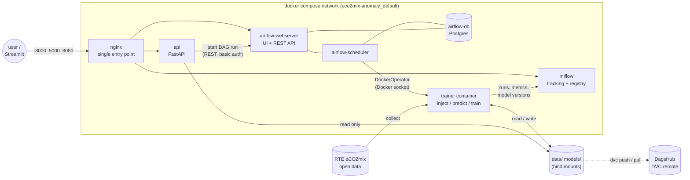
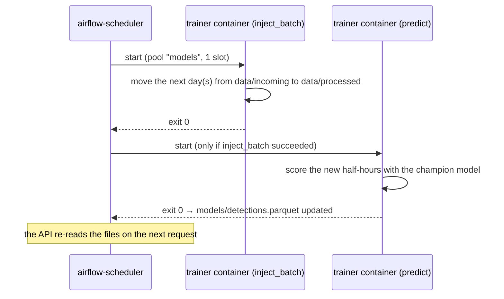
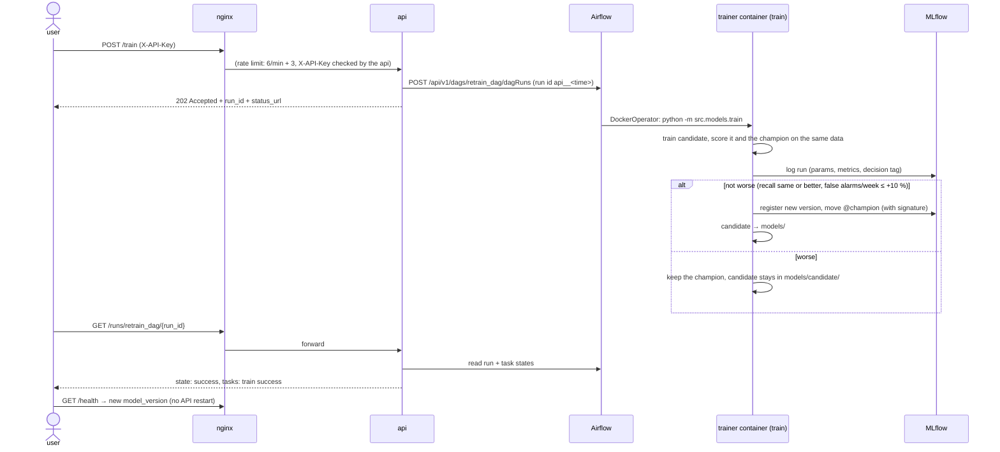
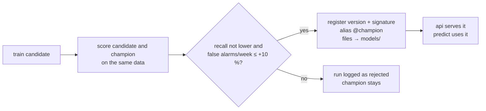

# Architecture

How the services of eco2mix-anomaly fit together: what each one does, who
talks to whom, where data and models live, and the main flows. For running
the project see the [README](../README.md); for how changes reach the
running system see [CI/CD strategy](cicd_strategy.md).

## Overview

The design in one sentence: **NGINX is the only door, the API is the only
way to start jobs, Airflow is the only place where the workflow is defined,
and every job runs in the same trainer image.**

## Services

| Service | Image | Kind | Job | Ports on the machine |
|---|---|---|---|---|
| `nginx` | `nginx:1.28-alpine` | always on | Single entry point: forwards to API, MLflow, Airflow; rate limit on job endpoints, body limit, security headers | **8000, 5000, 8080** (only service with ports) |
| `api` | own, `python:3.12-slim` | always on | FastAPI: serves stored results (`/health`, `/anomaly-day`, `/anomalies`, `/series`, `/model-info`); starts jobs via Airflow (`POST /train`, `POST /predict`, `GET /runs/…`) | none (behind nginx) |
| `mlflow` | `ghcr.io/mlflow/mlflow:v3.17.0` | always on | Tracking server (experiments `grid-anomaly-detection`, `detector-comparison`) and Model Registry (`grid-anomaly-detector`, alias `@champion`) | none (behind nginx) |
| `airflow-webserver` | own, `apache/airflow:2.11.2` + docker provider | always on | Airflow UI and REST API v1 | none (behind nginx) |
| `airflow-scheduler` | same | always on | Starts due DAG runs; with LocalExecutor it also runs the tasks | none |
| `airflow-db` | `postgres:16` | always on | Airflow metadata: DAG runs, task states, users, pool | none |
| `airflow-init` | same as Airflow | one-off | Database migration, admin user, pool `models` (1 slot) | none |
| trainer container | own, `python:3.12-slim` | **job** (start → work → stop) | Started by Airflow for each task: `inject_batch`, `predict`, `train` | none |
| `trainer` / `batch` | same trainer image | one-off / on demand | Manual runs without Airflow (`docker compose run --rm trainer`) | none |

**Always-on vs jobs** (Kilyan, 30 Oct): the API, MLflow and Airflow must
always answer (predictions, model downloads, run status). Training and batch
scoring only run when needed and give their memory back afterwards. Measured
on a 16 GB laptop: ≈ 3.6 GB for the always-on services, ≈ 5 GB while a job
runs → requirement: **at least 8 GB RAM available to Docker**.

## Who talks to whom

| From | To | How | Authentication |
|---|---|---|---|
| Browser, curl, Streamlit | nginx `:8000 / :5000 / :8080` | HTTP | API: `X-API-Key` on `/train`, `/predict`; Airflow UI: Airflow login; MLflow UI: none (local) |
| nginx | api `:8000`, mlflow `:5000`, airflow-webserver `:8080` | HTTP reverse proxy, names resolved per request by Docker DNS | — |
| api | airflow-webserver `:8080` `/api/v1/…` | REST: trigger a DAG run, read run and task states | Basic auth, Airflow user from `.env` (production: service account with only DAG-run rights) |
| airflow-scheduler | Docker (host) | Docker socket `/var/run/docker.sock` | socket group (`DOCKER_GID`) |
| trainer container | mlflow `:5000` | MLflow client (`MLFLOW_TRACKING_URI=http://mlflow:5000`) | none (internal network) |
| trainer container | RTE open data | HTTPS download (only if processed data is missing) | none (public data) |
| Developer | DagsHub | `dvc push / pull` | personal token in `.dvc/config.local` (never in git) |

Services inside the network talk **directly**, not through nginx. nginx only
guards the way in from outside.

## Where things are stored

| What | Where | Versioned by |
|---|---|---|
| Code, configs, DAGs, Dockerfiles | git (GitHub) | git |
| Raw, processed and incoming data | `data/raw`, `data/processed`, `data/incoming` | **DVC** (`data/*.dvc` in git, files on DagsHub) |
| Model in use (champion) | `models/` (`model.joblib`, `metadata.json`, `detections.parquet`, `anomaly_days.csv`) | **MLflow Model Registry** (each promoted model = new version, alias `@champion`) |
| Candidate of the last retrain | `models/candidate/` | MLflow run (also when rejected) |
| Runs, metrics, model artifacts | `mlflow/` (SQLite + artifacts) | MLflow |
| Airflow runs and logs | volume `airflow-db-data`, folder `airflow/logs` | — |
| Secrets (passwords, keys, tokens) | `.env`, `.dvc/config.local` | **never in git** (`.env.example` shows the names) |

`models/`, `mlflow/` and `airflow/` are git-ignored: they are produced by the
system, not written by hand.

## Main flows

### 1. Daily batch prediction (`batch_dag`, `@daily`)

The 20 % held back at the split (`data/incoming`) is released day by day to
simulate new data arriving.

### 2. Retraining on request (`POST /train` → `retrain_dag`)

The same DAG also runs every Sunday by itself (`@weekly`). Later the drift
check (Phase 4) can call the same endpoint, so there is **one** retraining
workflow, however it is started.

### 3. Model lifecycle

Each registered version carries a **signature**: inputs `actual`, `expected`
(double) → outputs `z_score` (double), `is_anomaly` (boolean); parameter
`detector` (default `mstl`). MLflow refuses calls with other columns or types.

## Security layers

| Layer | What | Status |
|---|---|---|
| Entrance | nginx is the only service with ports; rate limit on `/train`, `/predict` (429); 1 MB body limit (413); security headers; version hidden | ✅ |
| API | `X-API-Key` on `POST /train`, `POST /predict` (missing → 401, wrong → 403, not configured → 500), compared with `secrets.compare_digest`; read endpoints open. Next step: JWT + roles (user → predict, admin → train) | ✅ |
| Between services | internal network only; API → Airflow with basic auth (admin user for this project; production: dedicated service account with only DAG-run permissions, so a leaked key cannot delete users or connections, and API actions are distinguishable from human ones) | ✅ |
| Secrets | `.env` and `.dvc/config.local`, git-ignored; random passwords and keys generated locally | ✅ |
| Model | signature checks inputs; promote-or-reject blocks worse models | ✅ |

## Design decisions

| Decision | Why | Alternative considered |
|---|---|---|
| Airflow with **LocalExecutor** | Our jobs run one after another; 4 containers instead of 6 (no Redis, worker, Flower); lighter on a 16 GB laptop | CeleryExecutor (course setup); Prefect |
| **DockerOperator** on the trainer image | Airflow only orchestrates; jobs run with exactly the same code and packages as without Airflow; no package conflicts inside Airflow | PythonOperator with all packages installed in Airflow |
| **API calls Airflow** (not the reverse) | The workflow (steps, retries, pool) is defined once; schedule, API and drift alerts use the same DAG (Kilyan, 30 Oct) | API running the training itself |
| Pool `models` with **1 slot** | `batch_dag` and `retrain_dag` never write `models/` at the same time; also limits peak RAM | locks in the code |
| **MLflow registry** for model versions | Versions, metrics, signature and alias in one place; DVC only for data (Kilyan, 30 Oct) | `dvc add models/` |
| **DagsHub** as DVC remote | Free, shared between team members, no server to run | MinIO / SeaweedFS (S3-compatible, next step) |
| **nginx** in front | One door to secure and monitor; the services are not reachable directly | each service with its own port |
| 202 + run id for jobs | Training takes ≈ 40 s; never keep an HTTP request open for a long job | synchronous endpoint |

## Limits and next steps

- Everything runs on one machine with docker compose. With more load:
  Kubernetes to spread containers over several machines (e.g. training on
  a separate node).
- MLflow runs are local to each laptop (`mlflow/`); a shared tracking server
  (e.g. DagsHub's MLflow) would let the team see the same runs.
- Images are built locally; in production they would be built and tested in
  CI and pulled from a registry (see [CI/CD strategy](cicd_strategy.md)).
- The API logs in to Airflow as admin; production: a service account limited to starting DAG runs.
- Authentication is one shared API key; production: JWT with roles, users in a database.
- Monitoring (Prometheus, Grafana, Evidently drift, alerts) comes in Phase 4.
