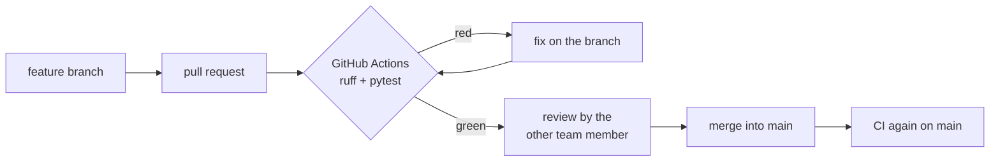
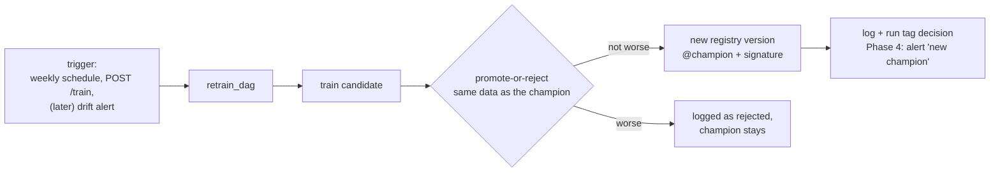

# CI/CD strategy

What happens when something changes: **code**, **data** or the **model**.
Each kind of change has its own path, its own automatic checks and, where it
matters, a human decision. See [Architecture](architecture.md) for the
services.

```
 change in      handled by           automatic gate                   human step
 ─────────      ──────────           ──────────────                   ──────────
 code       ──▶ GitHub Actions  ──▶  ruff + pytest on pinned versions ──▶ PR review, merge
 data       ──▶ Airflow (daily)  ──▶  inject → predict (only if inject succeeded)
 model      ──▶ Airflow / API    ──▶  promote-or-reject vs the champion ──▶ (optional) approval
```

In one line: **GitHub Actions runs when the code changes, Airflow runs when
the data changes.**

## 1. Code changes (CI)



- **Every change goes through a branch and a pull request**; nobody pushes to
  `main` directly.
- **CI** (`.github/workflows/ci.yml`) runs on every pull request and on every
  push to `main`: `ruff check` (style and errors) and `pytest` (unit tests,
  API tests with a fake Airflow, compose/NGINX consistency, DAG tests when
  Airflow is installed).
- **Pinned versions:** CI installs `requirements.lock.txt`, the same pinned
  versions as the development setup, so a green CI means the code works with
  exactly the versions we run (Kilyan, 30 Oct).
- **Protected `main`** (GitHub branch protection): merging needs a green CI
  and one approving review. Example: PR #21 (API key) — CI green, reviewed and
  approved by the other team member, then merged.
- Tests never need running services: Airflow and MLflow are replaced by fakes
  (`app.dependency_overrides`), so CI is fast (≈ 1 min) and free.

## 2. Data changes (continuous prediction)

- New data arrives day by day (`batch_dag`, daily): `inject_batch` →
  `predict`. `predict` only runs if `inject_batch` succeeded, so we never
  score half-written data.
- Failed tasks are retried once after 2 minutes; a red task can be re-run
  alone in the Airflow UI (no double injection).
- Data versions are kept with DVC (`data/*.dvc` in git, files on DagsHub);
  any older state can be restored with `git checkout` + `dvc pull`.
- Phase 4: a scheduled drift check (Evidently) compares new batches with the
  training data → Grafana panel and alert; strong drift can start a retrain
  through `POST /train`.

## 3. Model changes (continuous training)



- **One workflow:** whatever starts a retraining (schedule, API, drift), it
  is the same Airflow DAG.
- **Automatic gate = promote-or-reject:** the candidate replaces the
  champion only if recall does not drop and false alarms per week rise by at
  most 10 %, measured on the same data. Example: a model with K = 2 was
  rejected automatically (false alarms/week 0.51 → 2.55).
- **Traceability:** every run is in MLflow with parameters, metrics, the
  champion's scores and the decision tag; every promoted model is a registry
  version with a signature.
- **Awareness:** a new model must never go live unnoticed (Kilyan, 30 Oct).
  Today: the Airflow log, the MLflow run tag and `GET /health`
  (`model_version`). Phase 4: Grafana alert when the champion changes.

### Human approval (option)

Fully automatic promotion is acceptable for this project because the gate
compares against the champion on the same data and every change is logged.
Where a human decision is wanted, the same pipeline supports it with one
change: promote-or-reject gives the new version the alias `@challenger` and
sends a notification; a person moves `@champion` in the MLflow UI after
looking at the comparison. The API and batch jobs always load
`@champion`, so nothing else changes.

## 4. Deployment (CD)

| Today (local, docker compose) | In production |
|---|---|
| Images are built on each machine (`docker compose build`) | CI builds the images once, runs the tests against them and pushes them to a registry (e.g. GitHub Container Registry), tagged with the commit |
| `docker compose up -d` starts the stack | The server only **pulls** the tested images and restarts the services; nothing is rebuilt in production (the same image that passed CI runs) |
| Secrets in `.env` | Secrets in the platform's secret store (GitHub Actions secrets, Kubernetes secrets, a vault) |
| One machine | Kubernetes or Docker Swarm for several machines; training on its own node |

Releases are tagged in git at the end of each phase (`v0.3` = Phase 3).

## Status

| Item | Status |
|---|---|
| Branch + PR workflow, review | ✅ in use |
| CI: ruff + pytest on pinned versions, every PR and push to `main` | ✅ (≈ 1 min per run) |
| Protected `main` (green CI + 1 review) | ✅ |
| `batch_dag` / `retrain_dag` with retries and 1-slot pool | ✅ |
| Promote-or-reject gate, MLflow registry, signature | ✅ |
| Retraining through the API (`POST /train` → Airflow) | ✅ |
| Alerts on new champion, drift check | ⏳ Phase 4 |
| Images built in CI (api, trainer, airflow; no push) | ✅ (job `docker-build`) |
| Images pushed to a registry | optional (described above) |
| Human approval with `@challenger` | optional (described above) |
